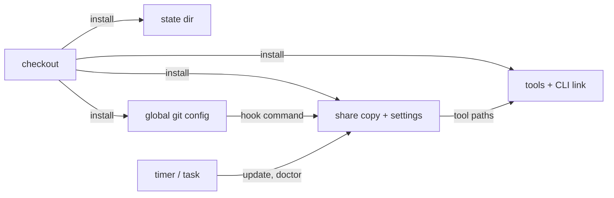
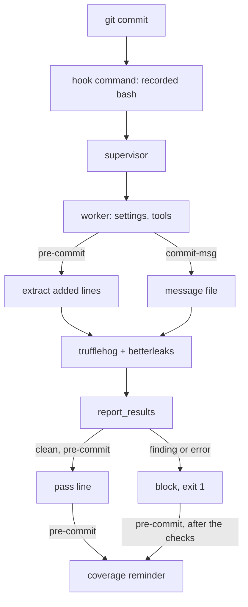

# Architecture

How git-secret-guard fits together, in one read. Each section says what a part is and why it is there, and links the page that
holds the detail and its maintainer notes. The rules themselves live on those pages; [CLAUDE.md](../CLAUDE.md) is the index of the
invariants.

## The parts and where they live

Paths as the Linux and macOS docs write them; on Windows `~` is `%USERPROFILE%`, the `HOME` of Git Bash. A set `XDG_*` variable
takes the place of the default shown.

| Part | Where | What it is |
|---|---|---|
| Checkout | the clone `install` ran from | the source. Install copies from it; auto-update follows its released tags ([install.md](install.md#auto-update---auto-update-and-update)) |
| Share copy | `${XDG_DATA_HOME:-~/.local/share}/git-secret-guard/` | `hooks/`, `lib/`, `bin/`, `tools.lock`, `VERSION` and the generated `settings`: what git and the installed CLI run. An install builds it complete and swaps it in, except a run from the installed copy on Windows or WSL 1, which rewrites only `settings` and the Windows `jq` wrapper ([install.md](install.md#what-install-does)) |
| `settings` | `<share>/settings` | absolute tool paths, pinned versions, the scan timeout, `BASH_BIN`, the hash of our rule file; the hook sources it ([scan.md](scan.md#the-settings-file)) |
| Global git config | `git config --global` | `hook.git-secret-guard.event` (`pre-commit`, `commit-msg`) and `hook.git-secret-guard.command`, which checks the recorded bash and `exec`s it with the installed hook |
| Tools | `~/.local/bin/` | `trufflehog` and `betterleaks` (`.exe` on Windows, where a missing `jq` is downloaded too), kept when one reports the pinned version, else downloaded and checked against the SHA-256 of `tools.lock` ([install.md](install.md#pinned-tools-toolslock)) |
| CLI | `~/.local/bin/git-secret-guard` | a link to `<share>/bin/git-secret-guard` (a wrapper and a `.cmd` on Windows); install puts the folder on `PATH` on macOS and Windows |
| State dir | `${XDG_STATE_HOME:-~/.local/state}/git-secret-guard/` | among them `state` (what install did, read by `status` and `uninstall`), `findings` (doctor's record), `update` (the last auto-update decision), the locks, `update.log` (macOS, Windows), `update-task.cmd` (Windows) and `smartgit/` (SmartGit backups) |
| Scheduled jobs | systemd user units, LaunchAgents, a Task Scheduler task | the weekly doctor (`--with-timer`) and the hourly update (`--auto-update`); only files with our marker line are rewritten or removed |

## The commit path

What one `git commit` runs; the step-by-step page is [scan.md#how-it-works](scan.md#how-it-works).

1. **Git's config hook.** git 2.54 or newer runs `hook.git-secret-guard.command` for `pre-commit` (no argument) and `commit-msg`
   (the message file), before the repository's own hooks; both run, and either failing blocks. Older git ignores config hooks
   without a word, which is why install requires git 2.54 and `doctor` looks for older gits.
2. **The recorded bash.** The hook command checks that `BASH_BIN` exists and `exec`s it with `<share>/hooks/secret-scan`, so the
   `#!/usr/bin/env bash` shebang never picks the interpreter ([scan.md](scan.md#how-it-works), step 2).
3. **Supervisor and worker.** `hooks/secret-scan` refuses a bash older than 4.4, finds its own location with `readlink` and `cd -P`,
   and starts itself again as a worker in its own process group (`proc_supervise` in `lib/core/proc.sh`). The first process only
   polls it, so HUP, INT and TERM stop even a slow git at once ([scan.md#signals](scan.md#signals),
   [scan.md#maintainer-notes](scan.md#maintainer-notes)).
4. **Checks.** The worker loads `lib/core/common.sh` and the libraries of `GSG_HOOK_LIBS`, reads `settings`, checks every tool
   path, and makes a private work dir. Any failure blocks with "nothing was scanned".
5. **The message** (`commit-msg`): the message file is prepared (`lib/core/message.sh`) and scanned with HEAD's betterleaks files;
   no path exemption, no reminder ([scan.md#the-commit-message](scan.md#the-commit-message)).
6. **The added lines** (`pre-commit`): exemptions are read from HEAD, the index is written as a tree and diffed against HEAD's,
   and each added line is put at its own line number in a scan tree (`lib/scan/extract.sh`, `extract.awk`). Git LFS pointers are
   replaced by their objects. The tree is read with bash globs, never `find`.
7. **Both scanners** run in parallel, each through `lib/scan/run-scanner.sh` in its own process group and under `timeout`, with
   no verification and a dead proxy ([scan.md#limits](scan.md#limits)).
8. **The verdict.** `report_results` (`lib/scan/report.sh`) cross-checks each scanner's exit status against the rows that reached
   it and prints the findings (scanner, rule, file, line, never a value); the hook then exits 1, or for `pre-commit` prints the one
   pass line (`report_pass_line`). A clean `commit-msg` run prints nothing.
9. **The coverage reminder** (`pre-commit` only, once the work dir exists). When doctor's record holds problems (or is damaged),
   the hook empties its work dir and starts `doctor --recheck` as a separate process; the commit's exit status never depends on
   it ([scan.md#the-coverage-reminder](scan.md#the-coverage-reminder)).

## The CLI path

`bin/git-secret-guard` finds its location the same way as the hook (its share is two levels up, in a checkout and in the installed
copy alike), runs the Homebrew bootstrap of `lib/platform/brew.sh` (bash 3.2 safe; on macOS it re-executes under a newer bash),
loads the CLI libraries listed in the script and dispatches. The commands:

| Command | Reads | Writes |
|---|---|---|
| `install` | platform, git, `core.hooksPath`, state, `tools.lock`, the checkout | in this order: the checks that can refuse (an accepted git upgrade runs among them), the hooks-dir backup, the state, tools, share tree, CLI link, global git config, `core.hooksPath` unset last of the hook changes; then the `PATH` change, the timer, auto-update, SmartGit and Desktop steps ([install.md#maintainer-notes](install.md#maintainer-notes)) |
| `status` | state, settings, share, global config, git's own hook listing, job files | nothing; exit 1 when not installed or on any `MISMATCH` or `MISSING` ([install.md#status-and-version](install.md#status-and-version)) |
| `doctor` | the machine and every repository under the roots (default: home) | only its findings record ([doctor.md](doctor.md)) |
| `update` | state, the recorded checkout | the owner's fetch and fast-forward, a tag export, a child `install`, the update record ([install.md](install.md#what-one-run-does)) |
| `uninstall` | state | after the update and findings locks: restores SmartGit and removes the Desktop link, restores `core.hooksPath` before it removes the hook config, then the timers, CLI link, `PATH` entry and share, puts back the originals install moved aside, removes the downloaded tools only with `--remove-tools`, and last the findings, update record and state ([install.md#uninstall](install.md#uninstall)) |

`status` and `doctor` judge the hook with the same probe: one `git hook list` per event in a bare repository written by hand, so
the verdict is git's own ([install.md#maintainer-notes](install.md#maintainer-notes)). `restore-system-git`, `restore-smartgit` and
`unlink-desktop-git` undo one integration each.

## The bounded contexts of `lib/`

One folder per context, no file directly in `lib/`. Each README says what belongs there and what it may depend on.

| Folder | Holds | Loaded by |
|---|---|---|
| [core](../lib/core/README.md) | constants, settings loader, hook file lists, process groups, state record, message check | hook and CLI; sources nothing outside `lib/core/` |
| [scan](../lib/scan/README.md) | extraction, exemptions, report, scanner runner and adapters, our rule file | hook; the CLI loads `exempt.sh` for doctor |
| [install](../lib/install/README.md) | install, uninstall, tools, `core.hooksPath`, CLI on `PATH` | CLI |
| [inspect](../lib/inspect/README.md) | `status`, `doctor` and its findings record | CLI |
| [autoupdate](../lib/autoupdate/README.md) | the update cycle, the doctor and update timers | CLI |
| [gitup](../lib/gitup/README.md) | the git upgrade: shared plan plus one module per OS | CLI |
| [integrations](../lib/integrations/README.md) | `smartgit/`, `desktop/` | CLI |
| [platform](../lib/platform/README.md) | Homebrew, launchd, Task Scheduler, `PATH` on macOS and Windows, WSL | CLI |
| [cli](../lib/cli/README.md) | `usage.md`, the help text | CLI (read, not sourced) |

The hook loads only `lib/core/` and `lib/scan/`, through `GSG_HOOK_LIBS` and `GSG_HOOK_FILES` in `lib/core/common.sh`; a new hook
library goes there and nowhere else. `tests/project/test_quality.sh` enforces these rules; where a new file goes:
[CONTRIBUTING.md#where-a-new-file-goes](../CONTRIBUTING.md#where-a-new-file-goes).

## The trust model

- **Tool paths come from the settings file only**: `jq`, both scanners, `setsid` (`taskkill` on Windows), `timeout` and the bash.
  An inherited variable of the same name is dropped first, and an unusable path blocks the commit
  ([scan.md#the-settings-file](scan.md#the-settings-file)). Everything else the hook runs comes from `PATH`; the gaps that leaves
  and the cross-check that closes two of them: [scan.md#how-it-works](scan.md#how-it-works), steps 2 and 5.
- **A commit cannot mute itself.** `.secret-scan-ignore`, `.gitleaks.toml` and `.gitleaksignore` are read from HEAD, never from the
  index or the work tree ([exemptions.md](exemptions.md), [exemptions.md#maintainer-notes](exemptions.md#maintainer-notes)).
- **Nothing a repository configures is run by doctor**, and it contacts no remote: it reads other people's checkouts
  ([doctor.md](doctor.md)). The hook runs in the committer's own repository, where git already runs that configuration.
- **Fail closed.** A missing tool, a bad setting, a failed extraction, an unverifiable LFS object or a scanner error blocks the
  commit; an error never becomes a pass ([CONTRIBUTING.md#rules-for-changes](../CONTRIBUTING.md#rules-for-changes)).
- **Scanners are offline.** No credential is tested against a vendor, so a match that is not exempted blocks whether or not it is
  live ([scan.md#limits](scan.md#limits)).
- **Pinned files.** A downloaded scanner is checked by SHA-256 against `tools.lock`, our rule file against `BETTERLEAKS_RULE_SHA256`
  ([install.md#what-install-does](install.md#what-install-does)).
- **No value is printed**: findings name the scanner, rule, file and line ([scan.md#how-it-works](scan.md#how-it-works)).
- **Auto-update trusts the checkout's owner and whoever can push a release tag** ([install.md#trust](install.md#trust)).

## The lifecycle loops

- **Auto-update.** The hourly job runs `<share>/bin/git-secret-guard update`. Under the update lock, the owner of the checkout fetches
  `origin` (tags never forced) and fast-forwards to the newest valid tag, never past it; every user, owner or follower, exports
  that tag with `git archive` and runs its `install` as a child with no flags. The result is `updated` only when the installed
  `VERSION` is the tag's; a doubtful case is a recorded skip. Behaviour:
  [install.md](install.md#auto-update---auto-update-and-update); internals:
  [autoupdate-maintainer.md](autoupdate-maintainer.md#maintainer-notes-auto-update).
- **Coverage.** `doctor` (by hand or the weekly timer) writes the findings record; each commit's reminder re-checks it
  ([doctor.md#the-findings-record-and---recheck](doctor.md#the-findings-record-and---recheck)).
- **SmartGit.** SmartGit commits with the git its settings name. A plain install points it at a git 2.54 or newer by editing only the
  `executable:` lines of its `preferences.yml`, with a backup; `restore-smartgit` undoes it
  ([smartgit.md#the-automatic-way-a-plain-install](smartgit.md#the-automatic-way-a-plain-install)).
- **GitHub Desktop on Linux.** Its bundled git is older than 2.54 and cannot be replaced, so a plain install writes wrappers in
  `<share>/desktop-hooks/` that run the hook, checks them with Desktop's own git, and only then writes a launcher entry that passes
  `core.hooksPath` through `GIT_CONFIG_PARAMETERS`; `unlink-desktop-git` undoes it. On macOS and Windows install prints a note only
  ([install.md](install.md#github-desktop-on-linux---dont-link-desktop-git-and-unlink-desktop-git)).

## The platform seams

| | Linux | macOS | Windows | WSL |
|---|---|---|---|---|
| bash | the one that ran install, 4.4 or newer | Homebrew's; the CLI bootstraps from `/bin/bash` 3.2, GNU tools first through `GNUBIN_DIR` | Git for Windows bash | as Linux |
| Stopping processes | process groups (`setsid`) | process groups (`setsid` of util-linux) | no groups: `taskkill /T /F` of the descendants | as Linux |
| Scheduled jobs | systemd user units | LaunchAgents | a Task Scheduler task for the update; no doctor timer | systemd only when it runs |
| Paths | | | `/c/dir`, `C:/dir` and `C:\dir`, compared in one form | `git.exe` is a separate setup |
| CLI on `PATH` | a hint only | a marked block in the login shell's startup file | the user `Path`, through `bin/gsg-path.ps1` | as Linux |
| Git upgrade | `rpm` and `apt` modules | `macos` module (Homebrew) | `windows` module (the Git for Windows installer) | the `wsl` wrapper module |

A platform check reads `GSG_UNAME_S` and `GSG_UNAME_M`, filled once per process and never taken from the environment. Detail per
platform: [platforms.md](platforms.md) and its [maintainer notes](platforms.md#maintainer-notes); how each is tested:
[platform-testing.md](platform-testing.md).
